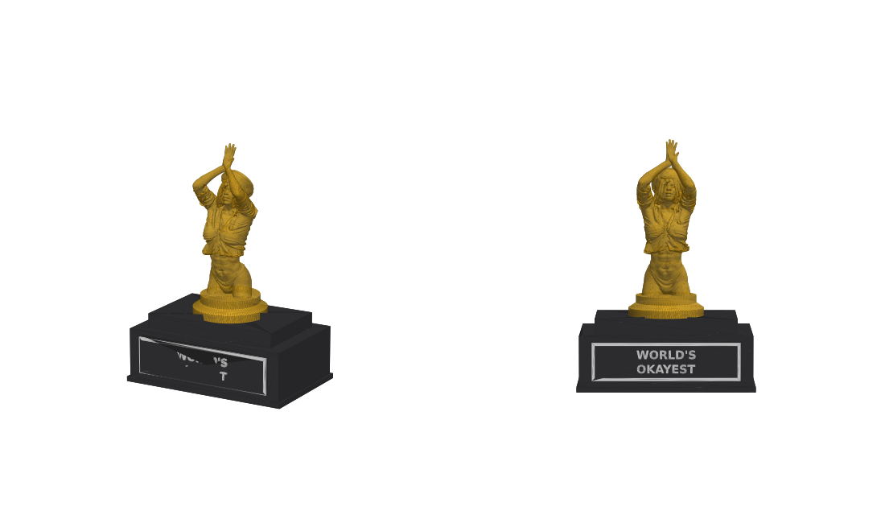

# award

A modular 3D-printable trophy. There's one common base with a plaque, and toppers that swap onto it: a cup, a treble clef, a lady, and more to come.
Everything is generated by Python scripts, and the STLs in this folder are the committed output.

| Cup | Treble clef | Lady |
|---|---|---|
|  |  |  |

## Files

| File | Made by | Colour | Print |
|---|---|---|---|
| `award_base.stl` | `award.py` | black | Upright, no supports. It has a peg on top and a pocket on the front for the plaque. |
| `award_cup.stl` | `award.py` | gold | Upright on its foot, no supports. |
| `award_clef.stl` | `clef.py` | gold | Upright on its foot, **with tree supports** under the curls. |
| `award_lady_topper.stl` | `lady.py` | gold | Upright on its foot, **with tree supports** under the raised arms. |
| `award_lady.stl` | not generated | | The source model for `lady.py`, 150 mm tall. At 35 MB it's gitignored, so it isn't in the repo: `lady.py` needs a local copy, and `award_lady_topper.stl` is committed. |
| `award_plaque.stl` | `award.py` | black, then white | Flat, text up. Add a filament change at z = 1.6 mm. |
| `award_plaque_black.stl` + `award_plaque_white.stl` | `award.py` | black + white | The same plaque split into two bodies for AMS/MMU printers. |
| `award_plaque_frame.stl` | `award.py` | white | Just the border, at z = 1.6–2.2 mm. Pair it with `award_plaque_black.stl` and add your text in Bambu Studio (see below). |

To assemble, glue the plaque into the pocket and drop the topper onto the peg (glue optional).

## Regenerating

```
pip install trimesh manifold3d shapely mapbox_earcut matplotlib
apt install fonts-freefont-ttf          # FreeSerif, for the clef glyph
python award.py --text "BEST\nHUMAN" --out .     # base, cup, plaques
python clef.py --out .                            # clef
python lady.py --out .                            # lady
python preview.py cup preview.png                 # preview renders
python preview.py clef clef_preview.png
python preview.py lady lady_preview.png
```

The scripts print each part's size and whether it is watertight; check that it is. If the plaque text is too long it's shrunk to fit. `award.py --assembled`, `clef.py --assembled` and `lady.py --assembled` also write the parts in their assembled positions as `assembled_*.stl`, which is useful for checking how they fit. Don't commit those files.

## Design spec

All dimensions are in mm. The constants are at the top of `award.py`, and `clef.py` imports them from there.

- **Base:** 70 × 45 footprint, which is the user's hard limit of **7 cm maximum width**. It's a 22 mm block with a 56 × 34 × 6 tier on top, so the top surface is at **z = 28**.
- **Plaque:** 58 × 15 × 1.6 black plate with a 0.6 mm white border and text, glued into a 1 mm deep pocket on the front of the base. The text is DejaVu Sans Bold.
- **Peg:** r = 4, 4 tall, in the centre of the top tier.
- **Clearance (`FIT`):** 0.2 per side for every part that slots into another.

### Topper interface

Every topper has to match the cup's:

- **Foot:** revolved profile `(15,0) (15,3) (11,5) (7,9)`, which is 30 mm across at the bottom.
- **Socket:** underneath the foot, r = PEG_R + FIT = 4.2 and depth PEG_H + FIT = 4.2. It's a short flat bridge when printing, which is fine.
- **Height:** **`CUP_H = 70`** above the base, so the whole award is 98 mm tall. Derive a new topper's height from `CUP_H`; don't hard-code it.
- **Origin:** z = 0 at the bottom of the foot, centred on the peg axis. That's also the print orientation.
- **Width:** stay under 70 (the cup is 58 across its handles).

`clef.py` is the template for a new topper. It makes a shape, sinks a hidden tab into the foot's neck so the two fuse solidly, unions it with the foot, and subtracts the socket.

The lady is the one exception to the foot profile. It keeps the 30 mm footprint and the socket, but the foot stops at `(12,5) (12,8)`, a wide collar instead of a neck, because a neck wouldn't hold both thighs.

## Adding your own text in Bambu Studio

1. Import `award_plaque_black.stl` and `award_plaque_frame.stl` together. When it asks whether to load them as a single object with multiple parts, say **yes**.
2. Give the plate black filament and the frame white.
3. Right-click the object, choose **Add part → Text**, place the text on the plate, set its depth to **0.6 mm**, and give it white filament.

## Notes and gotchas

- The clef glyph is U+1D11E from FreeSerif. Its strokes are thickened by 0.7 mm (`STROKE`) so they don't snap, and it's 6 mm thick.
- The clef used to be two parts: a flat-printed clef glued into a separate stand. The user wanted it as one piece that sits straight on the peg, so it now prints upright with supports.
- The lady's thighs are cut at a slant, not flat, so `lady.py` sinks them 4 mm (`SINK`) to bury the whole cut in the foot, and centres the thighs on the peg rather than the whole figure.
- `lady.py` simplifies the 700k-triangle source to about 160k (8 MB) with `TOLERANCE = 0.02`. The result sliced well. At 0.05 it's no longer watertight, so don't raise it without checking.
- Nothing has been test-printed yet, so the 0.2 mm `FIT` is unverified.
- In the left preview view the plaque looks smeared. That's matplotlib's painter's algorithm, not a fault in the model.
